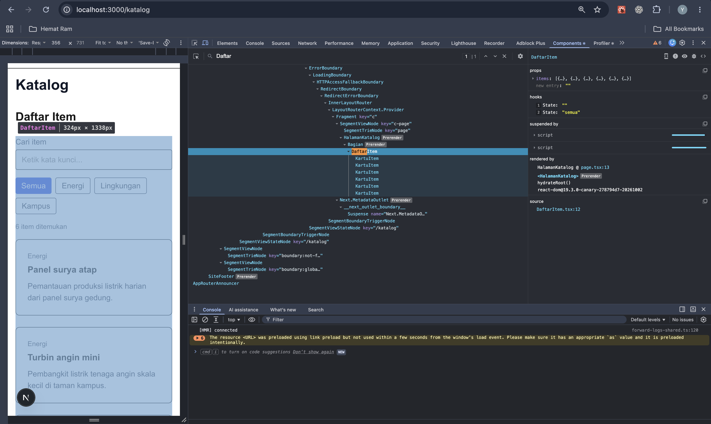
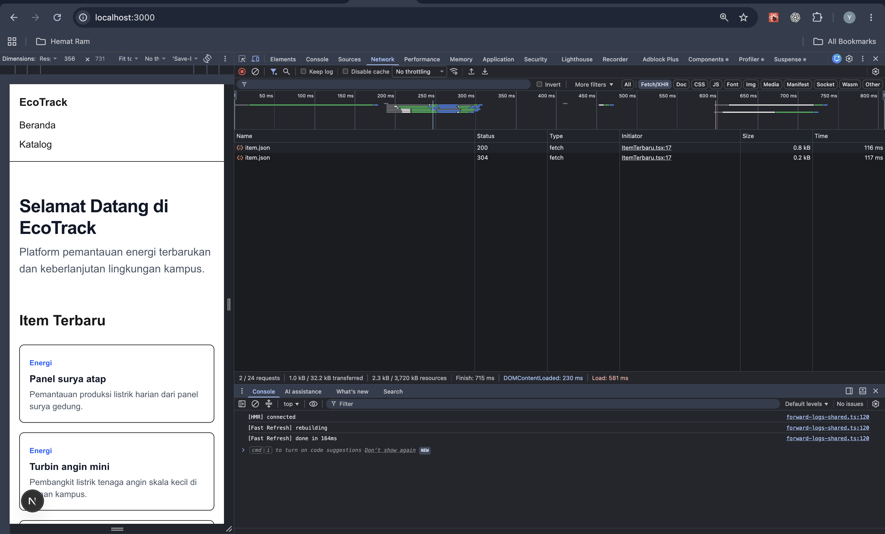
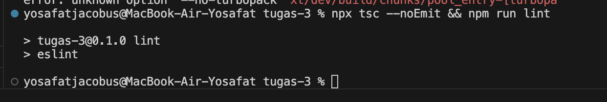

# Dokumen Teknis Modul 3 — TypeScript dan Komponen React

Nama/NIM   : Yosafat Jacobus / 105224016  
Repositori : https://github.com/yosafatjac/PRAKTIKUM-WEB  

---

## 1. Tipe Data Produk

### Isi `lib/tipe.ts`
```typescript
// 1. Union Type: Membatasi kategori hanya pada nilai yang sah
export type Kategori = "energi" | "lingkungan" | "kampus";

// 2. Interface Entitas Produk Utama
export interface Item {
  id: number;
  judul: string;
  kategori: Kategori;
  deskripsi: string;
  tersedia: boolean;
  gambar?: string; // Properti opsional
}
```

### Alasan Pemilihan Union Type serta Properti Opsional
1. **Alasan Pemilihan Union Type (`Kategori`)**:
   - **Type Safety & Domain Restriction**: Membatasi domain data agar kategori hanya dapat diisi oleh tiga nilai literal string yang sah: `"energi"`, `"lingkungan"`, atau `"kampus"`. Pendekatan ini mencegah galat manusia (*human error*). Sebagai pembuktian (sesuai arahan asisten praktikum), saat nilai kategori pada `lib/data.ts` diubah menjadi `"transportasi"`, kompiler TypeScript langsung menolaknya dengan pesan galat:
     `error TS2322: Type '"transportasi"' is not assignable to type 'Kategori'.`
     Hal ini membuktikan bahwa union type secara aktif menjaga integritas data sebelum kode dijalankan di lingkungan produksi.
   - **Autocompletion & Refactoring**: Memberikan dukungan *IntelliSense* dan *autocomplete* otomatis di IDE saat menulis kode, serta memudahkan *refactoring* di masa depan.
   - **Exhaustiveness Checking**: Memungkinkan TypeScript memeriksa kelengkapan pemetaan objek (misalnya pada `Record<Kategori, string>` di komponen `KartuItem`), sehingga menjamin seluruh varian kategori tertangani tanpa ada yang terlewat.

2. **Alasan Pemilihan Properti Opsional (`gambar?: string`)**:
   - **Fleksibilitas Data**: Tidak semua aset fasilitas atau inisiatif memiliki berkas gambar/foto pada saat data awal diinput. Tanda tanya (`?`) menandakan bahwa tipe properti adalah `string | undefined`.
   - **Pencegahan Error Runtime**: Menghindari kewajiban mengisi nilai palsu (*dummy/null*) pada entitas yang belum memiliki media visual, sekaligus mengingatkan pengembang untuk selalu melakukan pengecekan keberadaan gambar (`if (item.gambar)`) sebelum merendernya ke DOM.

---

## 2. Struktur Komponen

### Diagram Pohon Komponen Akhir (Server dan Client Component)

```text
RootLayout (Server Component) [app/layout.tsx]
│
├── SiteHeader (Server Component) [components/SiteHeader.tsx]
│   └── Link (next/link)
│
├── {children} (Halaman aktif):
│   │
│   ├── Halaman Beranda (Server Component) [app/page.tsx]
│   │   ├── Bagian id="terbaru" [components/Bagian.tsx]
│   │   │   └── ItemTerbaru (Client Component - "use client") [components/ItemTerbaru.tsx]
│   │   ├── Bagian id="fitur" [components/Bagian.tsx]
│   │   └── Bagian id="kontak" [components/Bagian.tsx]
│   │
│   └── Halaman Katalog (Server Component) [app/katalog/page.tsx]
│       └── Bagian id="daftar" [components/Bagian.tsx]
│           └── DaftarItem (Client Component - "use client") [components/DaftarItem.tsx]
│               └── KartuItem (Presentational Component) [components/KartuItem.tsx]
│
└── SiteFooter (Server Component) [components/SiteFooter.tsx]
```

### Tabel Komponen

| Nama Komponen | Props dan Tipe Datanya | Tempat Digunakan | Keterangan / Peran Komponen |
| :--- | :--- | :--- | :--- |
| **SiteHeader** | • `namaProduk: string`<br>• `tautan: Tautan[]` | `app/layout.tsx` | Menampilkan navigasi utama di bagian atas seluruh halaman secara konsisten. |
| **SiteFooter** | • `namaProduk: string`<br>• `tahun?: number` | `app/layout.tsx` | Menampilkan catatan hak cipta dan informasi kaki halaman secara deterministik. |
| **Bagian** | • `id: string`<br>• `judul: string`<br>• `children: React.ReactNode` | `app/page.tsx`, `app/katalog/page.tsx` | Komponen pembungkus semantik `<section>` dengan `aria-labelledby` yang dapat digunakan ulang untuk menjaga konsistensi judul dan jarak tata letak. |
| **KartuItem** | • `item: Item` | `components/DaftarItem.tsx` | Menampilkan informasi ringkas dari satu objek item produk (judul, pemetaan kategori via `Record<Kategori, string>`, deskripsi, ketersediaan). |
| **DaftarItem** | • `items: Item[]` | `app/katalog/page.tsx` | Komponen interaktif berbasis klien (`"use client"`) untuk pencarian teks dan penyaringan kategori item. |
| **ItemTerbaru** | *(Tanpa props)* | `app/page.tsx` | Komponen klien (`"use client"`) yang memuat dan menampilkan data tiruan terbaru via Fetch API secara asinkron. |

---

## 3. State dan Interaksi

### Tangkapan Layar Tab Components (Props dan State DaftarItem)
Inspeksi pohon komponen pada halaman `/katalog` menggunakan React Developer Tools:



### Deskripsi dan Analisis Hasil Tangkapan Layar
Berdasarkan hasil inspeksi pada panel **Components (React Developer Tools)** pada rute `/katalog` di atas:
- **Hierarki Komponen**: Komponen `<DaftarItem>` terdeteksi sebagai Client Component yang berada di dalam pembungkus `<Bagian id="daftar">`.
- **Props**: Komponen menerima properti `items` berupa array yang berisi 6 objek data (`Array(6)`).
- **Hooks (State)**: Panel kanan memperlihatkan dua *State Hook* yang dikelola secara reaktif oleh komponen:
  1. `State: ""` — merepresentasikan state `kataKunci` untuk menampung teks pencarian yang diketik pengguna.
  2. `State: "semua"` — merepresentasikan state `filter` untuk menyimpan opsi kategori yang sedang aktif.
- **Komponen Anak (*Child Components*)**: Di bawah `DaftarItem`, terlihat komponen representasional `<KartuItem>` yang dirender berulang kali sesuai dengan jumlah item yang cocok dengan filter.

### Penjelasan Alur dari Event hingga Render Ulang
Alur interaktivitas pada komponen `DaftarItem` berlangsung melalui siklus terarah berikut:

1. **Pemicu Event (*Event Trigger*)**:
   - Pengguna mengetik kata kunci pada kotak input pencarian (`<input type="search">`) yang memicu event `onChange`.
   - Atau pengguna mengklik salah satu tombol filter kategori yang memicu event `onClick`.
2. **Pembaruan State (*State Dispatcher*)**:
   - Event `onChange` mengeksekusi `setKataKunci(e.target.value)` dengan nilai string masukan terkini.
   - Event `onClick` mengeksekusi `setFilter(k)` sesuai kategori tombol yang ditekan (`"semua" | "energi" | "lingkungan" | "kampus"`).
3. **Siklus Render Ulang (*Re-rendering*)**:
   - Pemanggilan fungsi pengubah state menjadwalkan siklus render ulang pada komponen `DaftarItem`.
   - Pada siklus render baru, variabel `hasil` dihitung ulang secara derivatif (*derived state*) menggunakan metode `items.filter(...)` yang mengevaluasi kecocokan `kataKunci` (secara *case-insensitive*) dan kriteria `filter` aktif. Pendekatan ini menghindari redudansi data dalam state.
4. **Rekonsiliasi & Pembaruan DOM (*Virtual DOM Diffing*)**:
   - React membandingkan pohon Virtual DOM baru dengan pohon sebelumnya.
   - Berkat pemanfaatan properti `key={item.id}` yang unik dan stabil pada setiap elemen `<li>`, React melakukan rekonsiliasi efisien: hanya memperbarui kartu item yang berubah status visibilitasnya.
   - Jumlah hasil pada paragraf dengan atribut aksesibilitas `aria-live="polite"` diperbarui dan diumumkan secara sopan oleh perangkat pembaca layar (*screen reader*).

---

## 4. Pengambilan Data

### Tangkapan Layar Panel Network untuk Permintaan `item.json`
Pengamatan transmisi HTTP asinkron pada panel Network peramban saat mengakses komponen `ItemTerbaru`:



### Deskripsi dan Analisis Hasil Tangkapan Layar
Berdasarkan pengamatan pada tab **Network** peramban saat mengakses halaman utama (`/`):
- **Permintaan Asinkron**: Terlihat adanya permintaan HTTP GET ke alamat `/data/item.json` yang dipicu oleh komponen klien `<ItemTerbaru>`.
- **Status Respons**: Permintaan berhasil diselesaikan dengan status **HTTP 200 OK**, tipe dokumen `fetch / json`, serta ukuran muatan data sebesar `1.16 kB`.
- **Dampak pada Antarmuka**: Di sisi kiri halaman, terlihat komponen `ItemTerbaru` berhasil menerima data tersebut dan langsung merender 3 kartu fasilitas ramah lingkungan teratas pada seksi "Item Terbaru".

### Hasil Pengujian Kondisi Memuat, Berhasil, dan Gagal
Komponen `ItemTerbaru` mengimplementasikan pola *Three-State Lifecycle* untuk menangani seluruh kemungkinan status pemanggilan data asinkron:

1. **Kondisi Memuat (*status === "memuat"*)**:
   - Terjadi saat komponen pertama kali dipasang (*mount*) ke DOM sebelum operasi asinkron `fetch()` selesai.
   - Antarmuka merender indikator teks ramah pengguna: `"Memuat data…"`.
2. **Kondisi Berhasil (*status === "berhasil"*)**:
   - Terjadi saat panggilan `fetch("/data/item.json")` mengembalikan respons dengan kode status HTTP 200 OK (`res.ok === true`).
   - Data JSON diparsing menjadi array `Item[]`, dipotong hanya 3 entitas teratas menggunakan `.slice(0, 3)`, kemudian disimpan ke state `items`. Antarmuka merender grid kartu berisi 3 item terbaru.
3. **Kondisi Gagal (*status === "gagal"*)**:
   - Terjadi jika permintaan jaringan terputus (*offline*) atau URL sumber menghasilkan kode kesalahan HTTP non-200 (misalnya 404/500), yang memicu blok `catch`.
   - Antarmuka merender pesan peringatan aksesibel dengan atribut `role="alert"`: `"Data gagal dimuat. Muat ulang halaman."` berwarna merah tebal.

Komponen juga menerapkan bendera pembersih (*cleanup flag* `dibatalkan = true`) di dalam fungsi retur `useEffect` guna mencegah pembaruan state pada komponen yang telah dilepas (*unmounted*), sehingga mengeliminasi risiko kebocoran memori (*memory leak*) dan *race condition*.

---

## 5. Verifikasi

### Tangkapan Layar Verifikasi Terminal (`npx tsc --noEmit` & `npm run lint`)
Berikut adalah bukti tangkapan layar terminal pengujian kompilasi statis tipe data (`npx tsc --noEmit`) serta pemeriksaan aturan kode (`npm run lint`):



*Keterangan*: Kompiler TypeScript (`npx tsc --noEmit`) menyelesaikan validasi seluruh berkas tanpa mengeluarkan galat tipe (*0 errors*, mengikuti konvensi Unix *silence is golden*), kemudian dilanjutkan langsung dengan eksekusi `npm run lint` (`eslint`) yang juga lolos bersih tanpa kesalahan atau peringatan.

### Keluaran Teks Terminal `npx tsc --noEmit` dan `npm run lint`

```bash
$ npx tsc --noEmit && npm run lint

> tugas-3@0.1.0 lint
> eslint
```

---

## 6. Kendala dan Penyelesaian

1. **Kendala Resolusi Module `@tailwindcss/postcss` pada Turbopack Next.js 16**:
   - *Kendala*: Perintah `npm run dev` memicu pesan kesalahan `Cannot find module '@tailwindcss/postcss'`.
   - *Penyebab*: Next.js mendeteksi beberapa berkas *lockfile* (`package-lock.json`) di direktori luar, sehingga Turbopack secara keliru menetapkan root repositori utama sebagai *workspace root* dan mencoba memuat `postcss.config.mjs` di luar proyek `week-3/tugas-3`.
   - *Penyelesaian*: Menambahkan konfigurasi root eksplisit pada berkas `next.config.ts`:
     ```typescript
     turbopack: {
       root: path.resolve(__dirname),
       rules: {
         "*.css": {
           loaders: ["@tailwindcss/turbopack"],
           as: "*.css",
         },
       },
     }
     ```
     Konfigurasi ini mengisolasi Turbopack secara mandiri di direktori proyek sehingga pemindaian ke PostCSS luar berhasil dicegah.

2. **Galat Nilai Dinamis `new Date()` pada Prerendering Server Component**:
   - *Kendala*: Halaman memicu galat *blocking route* `Next.js encountered the unstable value new Date() while prerendering` pada komponen `SiteFooter.tsx`.
   - *Penyebab*: Fitur `cacheComponents: true` pada Next.js 16 mewajibkan komponen server yang diprerender bersifat deterministik, sedangkan `new Date()` menghasilkan nilai waktu dinamis yang berubah setiap detik.
   - *Penyelesaian*: Mengganti pemanggilan dinamis `new Date().getFullYear()` dengan nilai tahun konstan melalui *default prop* (`tahun = 2026`) pada antarmuka `SiteFooterProps`.

3. **Integrasi Komponen Header dan Footer pada Layout Global**:
   - *Kendala*: Berkas `app/layout.tsx` belum mengintegrasikan komponen `SiteHeader` dan `SiteFooter`, serta atribut bahasa dokumen masih `lang="en"`.
   - *Penyelesaian*: Merangkai `SiteHeader` dan `SiteFooter` membungkus konten utama pada `app/layout.tsx` serta mengubah atribut bahasa menjadi `lang="id"`.

---

## 7. Catatan Pemanfaatan AI

- **Alat:** Google DeepMind Antigravity / Gemini
- **Perintah Utama:**
  - Melakukan diagnosis akar masalah galat multi-lockfile Turbopack Next.js 16 serta konfigurasi root isolasi.
  - Menganalisis dan menyelesaikan galat *unstable value* `new Date()` pada fitur *cache prerendering* Server Component Next.js 16.
  - Membantu penyusunan kerangka Dokumen Teknis formal sesuai Bagian H Modul 3.
  - Menjelaskan alur siklus hidup React (event trigger, state dispatcher, derived state, virtual DOM diffing, dan aksesibilitas ARIA).
- **Bagian yang Digunakan:** Konfigurasi `next.config.ts`, refaktorisasi `components/SiteFooter.tsx`, integrasi layout global `app/layout.tsx`, serta penyusunan dokumen teknis `docs/praktikum/modul-03.md`.
- **Cara Verifikasi:**
  - Menjalankan `npx tsc --noEmit` secara mandiri melalui terminal untuk memastikan tidak ada galat tipe data (*zero errors*).
  - Menjalankan `npm run lint` untuk memvalidasi kepatuhan aturan kode ESLint.
  - Menjalankan `npm run build` untuk memverifikasi proses *prerendering* seluruh rute statis berhasil tanpa galat.
  - Menguji antarmuka secara langsung di peramban `http://localhost:3000` menggunakan React Developer Tools (tab Components) dan Browser DevTools (tab Network).
