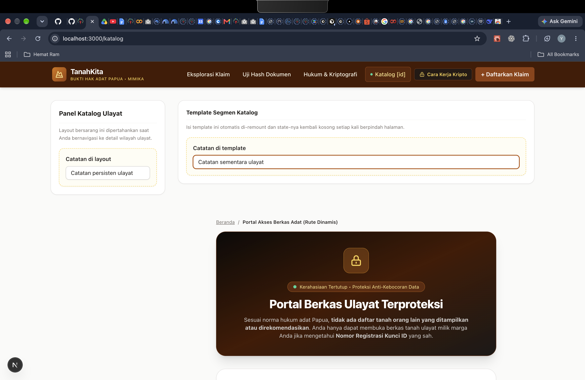
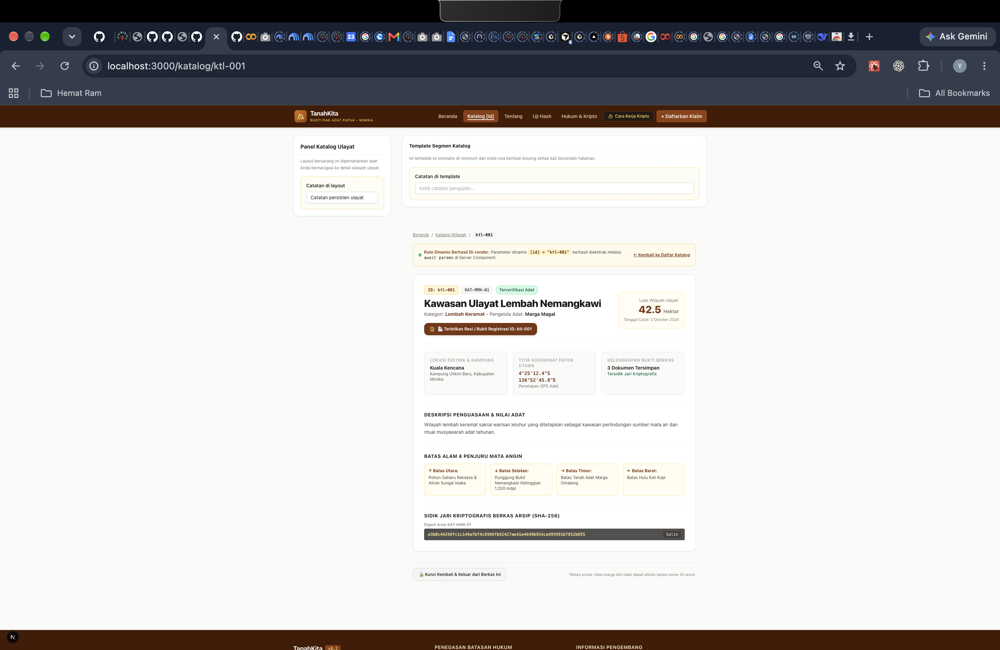
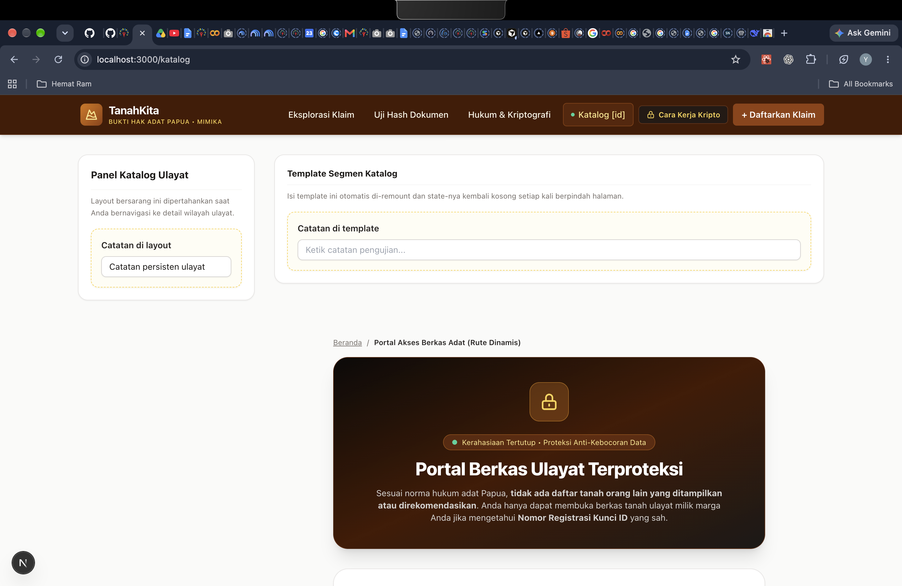
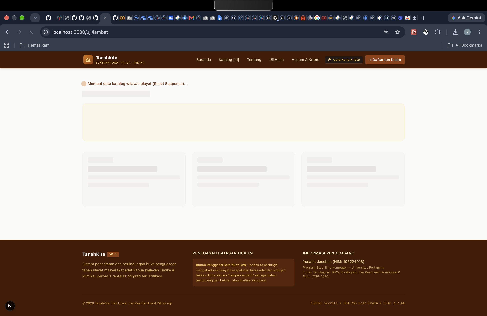
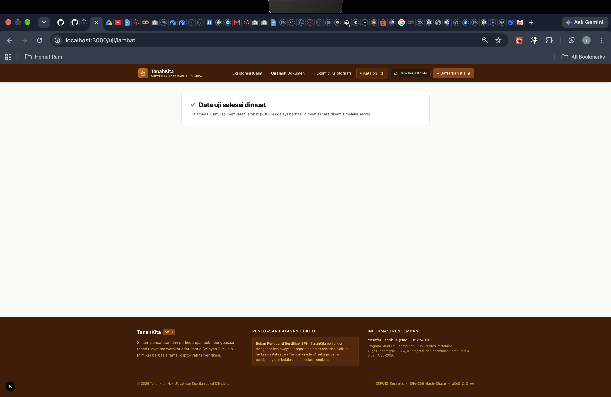
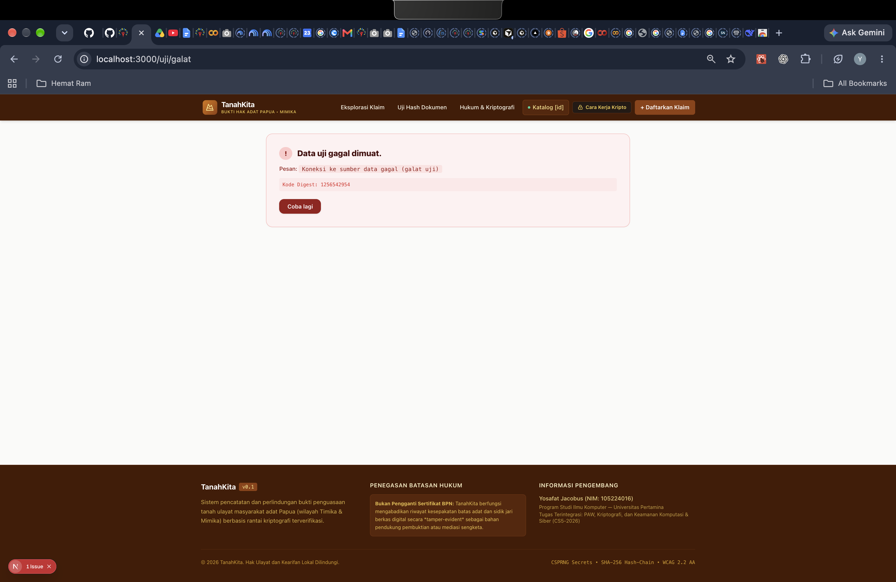
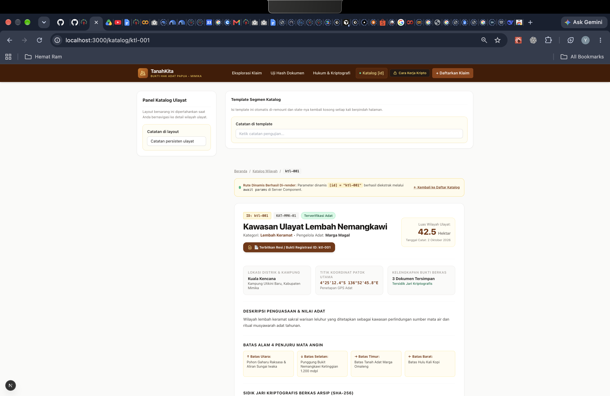
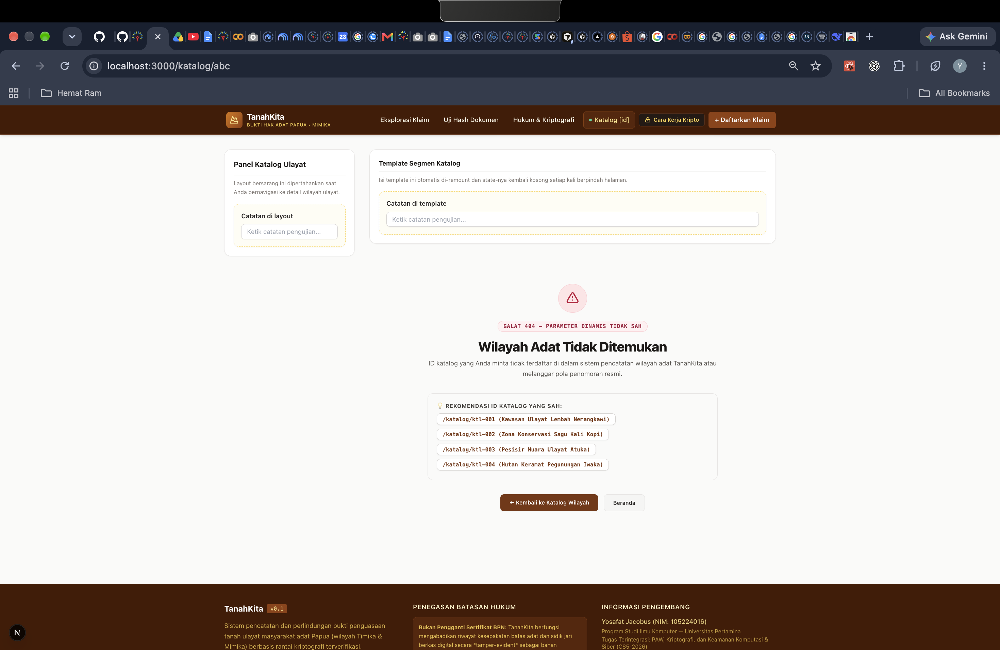

# Dokumen Teknis Modul 4: Next.js App Router

* **Nama / NIM:** Yosafat Jacobus / 105224016  
* **Repositori:** https://github.com/yosafatjac/PRAKTIKUM-WEB  
* **Branch kerja:** `praktikum/modul-04`  
* **Versi Next.js dan mode Cache Components (aktif/tidak):** Next.js 15.5.27 / tidak aktif (default App Router Next.js 15; `cacheComponents` tidak diaktifkan di `next.config.ts`)  

---

## 1. Peta Rute

### Catatan Padanan Rute dengan Rencana Tugas Pendahuluan (TP)
Pada dokumen Tugas Pendahuluan (TP) Modul 4, rencana rute dinamis awal dirancang pada URL `/klaim/[id]` untuk menampilkan register sengketa klaim tanah adat. Sementara itu, panduan laboratorium Modul 4 mewajibkan penerapan rute dinamis arsip ulayat pada segmen `/katalog/[id]`. Pada produk **TanahKita**, kedua rute tersebut diimplementasikan secara terpadu dan saling melengkapi:
- **`/katalog/[id]`** bertindak sebagai rute dinamis katalog arsip ulayat resmi sesuai spesifikasi Modul 4 (lengkap dengan *nested layout*, *template*, *loading*, *error boundary*, *SSG `generateStaticParams`*, serta proteksi *`server-only`*).
- **`/klaim/[id]`** bertindak sebagai rute dinamis rincian jejak audit (*audit timeline*) klaim marga sesuai rancangan di TP.

### Tabel Rute Aplikasi TanahKita
Rute berbasis berkas (*file-based routing*) pada direktori `src/app/` untuk produk **TanahKita** (Sistem Pencatatan dan Pembuktian Penguasaan Tanah Adat Papua):

| URL (Path) | Berkas di `src/app/` | Jenis Rute | Isi dan Fungsi Halaman |
| :--- | :--- | :---: | :--- |
| **`/`** | `app/page.tsx` | Statis | **Beranda Utama:** Menampilkan ringkasan klaim tanah adat, kartu statistik luas ulayat (hektar), komponen server `RingkasanArsip`, serta panel eksplorasi/pencarian klaim marga Mimika (`EksplorasiKlaim`). |
| **`/katalog`** | `app/katalog/page.tsx` | Statis | **Portal Berkas Ulayat Terproteksi:** Halaman indeks katalog yang dirender di server dan menampilkan antarmuka verifikasi Kunci ID (`FormAksesArsip`) untuk membuka berkas ulayat tanpa membocorkan daftar tanah marga lain. |
| **`/katalog/[id]`** | `app/katalog/[id]/page.tsx` | Dinamis (SSG) | **Detail Wilayah Adat Dinamis:** Menampilkan rincian satu wilayah ulayat berdasarkan parameter `[id]` (`await params`), patok batas 4 penjuru mata angin, sidik jari SHA-256 berkas arsip, dan fitur cetak resi bukti pencatatan (`ResiModal`). |
| **`/tentang`** | `app/tentang/page.tsx` | Statis | **Tentang Produk TanahKita:** Menjelaskan masalah batas lisan tanah adat Papua, pengguna sasaran (kepala marga, tetua adat, LBH), fitur utama 3-in-1, dan maklumat kepatuhan hukum non-BPN. |
| **`/daftar`** | `app/daftar/page.tsx` | Statis | **Formulir Pendaftaran Klaim Baru:** Input data ulayat baru, titik koordinat patok batas alam, kalkulasi hash SHA-256 berkas pendukung, dan penerbitan nomor registrasi `TK-MMK-2026-xxx`. |
| **`/verifikasi`** | `app/verifikasi/page.tsx` | Statis | **Portal Verifikasi Hash Adat:** Fasilitas uji integritas keaslian dokumen ulayat secara independen menggunakan Web Crypto API (SHA-256). |
| **`/edukasi`** | `app/edukasi/page.tsx` | Statis | **Panduan Hukum & Kriptografi:** Edukasi hukum masyarakat adat Papua (UUPA & Putusan MK No. 35/PUU-X/2012) serta perbandingan Hash vs Enkripsi vs Encoding. |
| **`/klaim/[id]`** | `app/klaim/[id]/page.tsx` | Dinamis | **Rincian Klaim Marga & Jejak Audit:** Menampilkan riwayat rantai waktu (*audit timeline*) dan verifikasi kesepakatan saksi batas. |

### Potongan Tabel Rute dari Keluaran `npm run build`
```text
Route (app)                                 Size  First Load JS
┌ ○ /                                    2.36 kB         114 kB
├ ○ /_not-found                            127 B         103 kB
├ ○ /daftar                              4.91 kB         111 kB
├ ○ /edukasi                               170 B         106 kB
├ ○ /katalog                             1.88 kB         108 kB
├ ● /katalog/[id]                        2.13 kB         108 kB
├   ├ /katalog/ktl-001
├   ├ /katalog/ktl-002
├   ├ /katalog/ktl-003
├   └ [+2 more paths]
├ ƒ /klaim/[id]                          3.42 kB         115 kB
├ ○ /tentang                               170 B         106 kB
└ ○ /verifikasi                          5.93 kB         112 kB
+ First Load JS shared by all             103 kB
  ├ chunks/255-ce8c7c75002f810b.js       46.5 kB
  ├ chunks/4bd1b696-c023c6e3521b1417.js  54.2 kB
  └ other shared chunks (total)          1.92 kB

○  (Static)   prerendered as static content
●  (SSG)      prerendered as static HTML (uses generateStaticParams)
ƒ  (Dynamic)  server-rendered on demand
```

---

## 2. Layout, Template, dan Berkas Khusus

### Pohon Folder `src/app/` Akhir
```text
src/app/
├── layout.tsx                  # Root Layout: Navbar global (TautanNav), Footer non-BPN, skip-link
├── page.tsx                    # Halaman Beranda (/) — Server Component
├── not-found.tsx               # Penanganan 404 global untuk URL di luar rute terdaftar
├── globals.css                 # Konfigurasi Tailwind CSS dan palet warna tanah ulayat
├── tentang/
│   └── page.tsx                # Halaman Tentang Produk (/tentang)
├── daftar/
│   └── page.tsx                # Halaman Pendaftaran Klaim (/daftar)
├── verifikasi/
│   └── page.tsx                # Portal Verifikasi Hash (/verifikasi)
├── edukasi/
│   └── page.tsx                # Panduan Edukasi Hak Ulayat (/edukasi)
├── klaim/
│   └── [id]/
│       └── page.tsx            # Detail klaim & riwayat rantai audit (/klaim/[id])
└── katalog/
    ├── layout.tsx              # Nested Layout: Header sub-segmen katalog & KolomCatatan persisten
    ├── template.tsx            # Template: Di-remount saat berganti rute anak (reset KolomCatatan)
    ├── loading.tsx             # Suspense fallback (role="status") saat segmen katalog dimuat
    ├── error.tsx               # Error boundary ("use client", role="alert") segmen katalog
    ├── page.tsx                # Halaman indeks Portal Akses Berkas Adat (/katalog)
    └── [id]/
        ├── page.tsx            # Detail dinamis wilayah ulayat (/katalog/[id])
        └── not-found.tsx       # Tampilan 404 segmen katalog jika ID tidak valid/tidak ditemukan
```

### Hasil Uji `layout.tsx` vs `template.tsx`

1. **Langkah 1: Sebelum Navigasi (`/katalog`):**  
   Kedua kolom input (`KolomCatatan` dengan label **"Catatan di layout (bertahan saat pindah halaman)"** dan **"Catatan di template (reset saat pindah halaman)"**) diisi dengan teks pengujian sebelum berpindah rute:
   

2. **Langkah 2: Navigasi ke Halaman Detail (`/katalog/ktl-001`):**  
   Pengguna berpindah ke rute dinamis `/katalog/ktl-001`. Terlihat jelas pada URL dan antarmuka bahwa catatan di layout **tetap bertahan**, sedangkan catatan di template **langsung ter-reset kosong** seketika rute anak dinamis dimuat:
   

3. **Langkah 3: Sesudah Kembali ke Katalog (`/katalog`):**  
   Setelah bernavigasi kembali ke indeks katalog ulayat:
   * Teks pada **"Catatan di layout"** **tetap bertahan (persisten)** karena *nested layout* (`src/app/katalog/layout.tsx`) tidak di-*unmount* selama pengguna berada di dalam sub-pohon `/katalog/*`.
   * Teks pada **"Catatan di template"** **kosong kembali (ter-reset)** karena Next.js membuat instans DOM/komponen baru (*remount*) pada `src/app/katalog/template.tsx` setiap kali segmen anak berganti:
   

### Tangkapan Layar `loading.tsx` dan `error.tsx`

1. **Tampilan `loading.tsx` (React Suspense Fallback):**  
   Menampilkan indikator pemuatan dengan atribut aksesibilitas `role="status"` saat halaman `async` sedang menunggu penyelesaian *Promise* di server (diuji melalui rute lambat sebelum folder `/uji` dibersihkan):
   * *Saat Proses Pemuatan Berlangsung (`loading.tsx` aktif):*
     
   * *Sesudah Selesai Dimuat (Halaman Akhir Berhasil Ditampilkan):*
     

2. **Tampilan `error.tsx` (Error Boundary):**  
   Menampilkan antarmuka pemulihan galat ramah pengguna (`role="alert"`) beserta pesan galat dan tombol **"Coba lagi"** (`retry` / `reset`) saat komponen halaman melempar *exception* di *runtime*:
   

---

## 3. Rute Dinamis dan Validasi params

### Tabel Uji Rute Dinamis
Pengujian parameter rute dinamis dengan 4 skenario uji (ID valid, format salah, ID tidak ada di data, dan URL di luar rute):

| URL yang Diuji | Hasil yang Diharapkan | Hasil Aktual | Kode Status |
| :--- | :--- | :--- | :---: |
| `http://localhost:3000/katalog/ktl-001` | Menampilkan detail *Kawasan Ulayat Lembah Nemangkawi* | Detail wilayah ulayat berhasil ditampilkan lengkap dengan batas 4 penjuru dan hash SHA-256 | **200 OK** |
| `http://localhost:3000/katalog/abc` | Menolak format ID dan menampilkan halaman `not-found.tsx` | Merender `src/app/katalog/[id]/not-found.tsx` dengan pesan parameter dinamis tidak sah | **404 Not Found** |
| `http://localhost:3000/katalog/ktl-999` | Menolak ID yang tidak ada di koleksi data | Merender `src/app/katalog/[id]/not-found.tsx` karena `cariItem("ktl-999")` bernilai `undefined` | **404 Not Found** |
| `http://localhost:3000/tidak-ada` | Menolak URL acak di luar segmen aplikasi | Merender `src/app/not-found.tsx` (halaman 404 tingkat *root*) | **404 Not Found** |

### Bukti Tangkapan Layar Detail Dinamis & Halaman Not Found
* **Tampilan Sukses Detail Dinamis (`/katalog/ktl-001`):**
  

* **Tampilan Halaman Not Found (`/katalog/abc`):**
  

### Penjelasan Aturan Validasi params
Pada Next.js 15/16, properti `params` pada komponen halaman dinamis bertipe `Promise<{ id: string }>`, sehingga wajib dibuka terlebih dahulu dengan `const { id } = await params;`. Setelah string `id` diperoleh, dilakukan validasi dua lapis di `src/app/katalog/[id]/page.tsx`:
1. **Validasi Pola Format (Regex):**  
   Diperiksa dengan ekspresi reguler `!/^(ktl-\d{3}|[1-9]\d*)$/i.test(id)`. Pola ini hanya mengizinkan format kode arsip resmi (`ktl-` diikuti 3 digit angka seperti `ktl-001`) atau bilangan bulat positif tanpa nol di depan. Jika pengguna memasukkan format liar seperti `/katalog/abc` atau `/katalog/0`, fungsi `notFound()` dari `next/navigation` langsung dipanggil sebelum pencarian data dijalankan.
2. **Validasi Keberadaan Data (*Data Lookup*):**  
   Jika format lolos, fungsi server `cariItem(id)` mencari objek di dalam `MOCK_KATALOG`. Apabila ID berformat valid tetapi tidak terdaftar (misalnya `/katalog/ktl-999`), nilai kembalian `undefined` memicu `if (!item) notFound();` dan mengembalikan status HTTP **404 Not Found**.

---

## 4. Pembagian Server dan Client Components

### Tabel Komponen dan Alasan Teknis

| Komponen & Lokasi Berkas | Jenis Komponen | Alasan Teknis |
| :--- | :---: | :--- |
| **`RingkasanArsip`**<br>`(src/components/RingkasanArsip.tsx)` | **Server Component** | • Membaca langsung 3 arsip terbaru dari modul `src/data/mockKatalog.ts` yang dilindungi `import "server-only"`.<br>• Tidak membutuhkan state atau event handler browser, sehingga kode dan data mentahnya tidak dikirim ke bundel JavaScript klien. |
| **`KatalogIndexPage` & `KatalogDetailPage`**<br>`(src/app/katalog/page.tsx`, `src/app/katalog/[id]/page.tsx)` | **Server Component** | • Mengeksekusi `await params`, `generateStaticParams()`, dan pembacaan data katalog di sisi server.<br>• Menurunkan ukuran *First Load JS* pada `/katalog` menjadi `1.88 kB` karena hanya mengirim HTML hasil render dan daftar ID terotorisasi ke komponen anak. |
| **`TautanNav`**<br>`(src/components/TautanNav.tsx)` | **Client Component**<br>(`"use client"`) | • Wajib menggunakan hook `usePathname()` dari `next/navigation` yang hanya tersedia di lingkungan browser untuk mendeteksi URL aktif.<br>• Menambahkan atribut aksesibilitas `aria-current="page"` secara dinamis pada tautan navigasi yang sedang dibuka. |
| **`KolomCatatan`**<br>`(src/components/KolomCatatan.tsx)` | **Client Component**<br>(`"use client"`) | • Memerlukan hook `useState` dan `useId` serta event handler `onChange` untuk menyimpan input ketikan pengguna di memori browser selama pengujian `layout.tsx` vs `template.tsx`. |
| **`FormAksesArsip` & `ResiModal`**<br>`(src/components/FormAksesArsip.tsx`, `src/components/ResiModal.tsx)` | **Client Component**<br>(`"use client"`) | • `FormAksesArsip` menggunakan `useState`, `useRouter`, dan event `onSubmit` untuk memvalidasi input Kunci ID dan menavigasi ke `/katalog/[id]`.<br>• `ResiModal` menggunakan state lokal `isOpen` dan API browser `window.print()` untuk mencetak resi bukti pencatatan ulayat. |
| **`ErrorKatalog`**<br>`(src/app/katalog/error.tsx)` | **Client Component**<br>(`"use client"`) | • Next.js mewajibkan seluruh berkas `error.tsx` mendeklarasikan `"use client"` karena *Error Boundary* React harus menangkap galat render di sisi klien dan mengeksekusi callback interaktif `retry()` / `reset()`. |

### Hasil Uji Batas `server-only`
Berkas sumber data katalog (`src/data/mockKatalog.ts`) diproteksi dengan baris `import "server-only";` di baris pertama. Saat dilakukan pengujian negatif dengan mengimpor `MOCK_KATALOG` ke dalam Client Component `src/components/KolomCatatan.tsx` (yang memiliki `"use client"`) lalu menjalankan `npm run build`, *bundler* Next.js langsung menolak kompilasi dengan pesan galat berikut:

```text
Failed to compile.

./src/data/mockKatalog.ts
Error:   x You're importing a component that needs "server-only". That only works in a Server Component which is not supported in the pages/ directory. Read more: https://nextjs.org/docs/app/building-your-application/rendering/server-components
  |

   ,-[/Users/yosafatjacobus/.gemini/antigravity/scratch/tanahkita/Pengembangan Aplikasi Web/src/data/mockKatalog.ts:1:1]
 1 | import "server-only";
   : ^^^^^^^^^^^^^^^^^^^^^
 2 | import type { KatalogItem } from "@/types/katalog";
 3 | 
 4 | export type { KatalogItem };
   `----

Import trace for requested module:
./src/data/mockKatalog.ts
./src/components/KolomCatatan.tsx

> Build failed because of webpack errors
```

Setelah pengujian selesai dan pesan galat dicatat, dua baris impor uji pada `KolomCatatan.tsx` dihapus kembali sehingga batas arsitektur *Server* dan *Client Component* tetap terjaga bersih.

---

## 5. Verifikasi

Ketiga perintah verifikasi dijalankan pada direktori aplikasi Next.js (`Pengembangan Aplikasi Web/`) dan seluruhnya lulus tanpa galat:

1. **Pemeriksaan Tipe TypeScript (`npx tsc --noEmit`):**  
   ```text
   (keluaran kosong — exit code 0, 0 errors)
   ```
2. **Pemeriksaan Linter (`npm run lint`):**  
   ```text
   > tanahkita@0.1.0 lint
   > next lint

   ✔ No ESLint warnings or errors
   ```
3. **Build Produksi (`npm run build`):**  
   ```text
   ▲ Next.js 15.5.27
   Creating an optimized production build ...
   ✓ Compiled successfully in 1979ms
   ✓ Linting and checking validity of types
   ✓ Collecting page data
   ✓ Generating static pages (14/14)
   ✓ Finalizing page optimization
   ```

---

## 6. Kendala dan Penyelesaian

1. **Kendala Penanganan `params` Asynchronous pada Next.js 15/16:**  
   * *Masalah:* Mengakses `params.id` secara sinkron di `src/app/katalog/[id]/page.tsx` tidak lagi sesuai dengan kontrak tipe App Router modern karena `params` dibungkus sebagai `Promise<{ id: string }>`.  
   * *Penyelesaian:* Menjadikan komponen halaman `async function KatalogDetailPage` dan mengekstrak parameter menggunakan `const { id } = await params;` sebelum melakukan validasi regex dan pencarian data.
2. **Kendala Impor Tipe vs Nilai Data pada Modul `server-only`:**  
   * *Masalah:* Ketika `import "server-only"` ditambahkan pada `src/data/mockKatalog.ts`, komponen klien yang mengimpor dari berkas tersebut ikut memicu penolakan kompilasi jika tidak dipisahkan antara kontrak tipe dan data server.  
   * *Penyelesaian:* Memisahkan definisi antarmuka `KatalogItem` ke `src/types/katalog.ts` serta mengekstrak formulir interaktif pada `/katalog` menjadi komponen klien `FormAksesArsip.tsx` yang menerima prop `validIds` dari *Server Component* `src/app/katalog/page.tsx`.

---

## 7. Catatan Pemanfaatan AI

* **Alat:** Antigravity (Google DeepMind)
* **Perintah Utama:** Membantu merancang struktur rute App Router pada proyek TanahKita (`/tentang`, `/katalog`, `/katalog/[id]`), pemisahan Server Component (`RingkasanArsip`) dan Client Component (`TautanNav`, `KolomCatatan`, `FormAksesArsip`), pengujian batas `server-only`, serta perapian laporan teknis sesuai panduan Modul 4.
* **Bagian yang Digunakan:** Struktur komponen `KolomCatatan`, `TautanNav`, `RingkasanArsip`, validasi regex `params` di `/katalog/[id]`, dan format dokumentasi `docs/praktikum/modul-04.md`.
* **Cara Verifikasi:** Seluruh kode diuji secara langsung melalui server pengembangan (`npm run dev`), pengujian navigasi browser (pengujian persistensi state layout vs reset state template), uji negatif kompilasi `server-only`, pemeriksaan tipe `npx tsc --noEmit`, `npm run lint`, dan `npm run build`.
